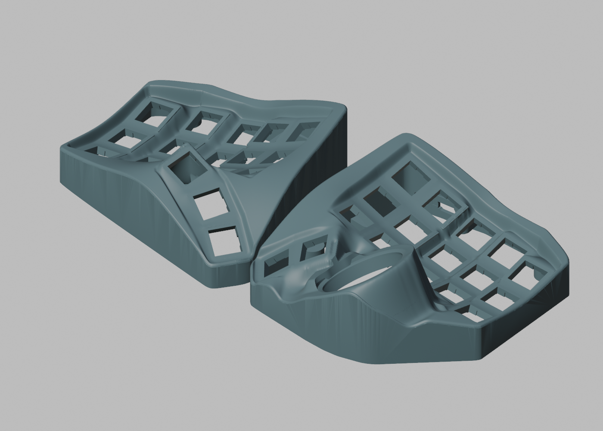

# Gyre Nano · 洄流

**English** | [简体中文](README.zh-CN.md)

A wireless, hot-swap split trackball keyboard enclosure derived from [BastardKB Charybdis Nano](https://github.com/Bastardkb/Charybdis). It keeps the familiar 3×5 keywell and thumb layout while replacing the open frame with a rounded, closed enclosure inspired by Charybdis MK2.

“Gyre / 洄流” echoes the swirling water of Charybdis; Nano denotes the compact layout. This is an independent derivative project.

**Current enclosure prototype: integrated raised shoulders and a rounded forward ball collar.** The latest upper shells preserve the original key/thumb/ball mounting relationships and reuse the existing bottom trays and FR4/FPC supports. Geometry and assembly-clearance checks have passed; these shells have not been sliced or physically assembled. Images show the current model.

[Latest models and checks](models/raised-rim/README.md) · [Ball-collar close-up](models/raised-rim/right-outer-seam.png) · [Top view](models/raised-rim/top.png)

## Layout and compatibility

- 3×5 main keys per half; three left thumb keys, two right thumb keys and a 34 mm trackball: 35 keys total.
- **Mounting positions and relative axes of the main keys, thumb keys and original trackball seat are preserved.** Baselines are mirrored Skeletyl V4 `case_v4_103.stl` on the left and Charybdis Nano `charybdisnano_v2_v187.stl` on the right. [Verification details](docs/geometry.md)
- The outer skin, thumb/ball transitions, sidewalls and bottom trays are redesigned. Height above the desk is not claimed identical to the original.
- Current electronics routes use FR4 or FPC keyfields, Kailh hot-swap sockets, header-mounted nrfmicro and ZMK. The original prototype used Amoeba Royale single-switch PCBs and Elite-C-holder; the new holder and support designs are linked below.
- Original holder mounting datums, a Type-C opening and bottom screw bosses adjacent to the sidewalls.
- Dedicated battery accommodation and a nice!view window remain planned. Ready-to-flash firmware is not included; the prototype PCB designs are linked below.

## Required prints

Print files are in [`models/`](models/) as **geometry-only 3MF**, in millimetres. Import at **100% scale** using your own printer profile; no printer settings or G-code are embedded. The left case is already mirrored.

| Part | File |
| --- | --- |
| Current right upper shell | [GyreNanoRightShell.3mf](models/raised-rim/GyreNanoRightShell.3mf) |
| Current left upper shell | [GyreNanoLeftShell.3mf](models/raised-rim/GyreNanoLeftShell.3mf) |
| Right bottom V7 | [gyre-nano-right-bottom-v7.3mf](models/3x5/gyre-nano-right-bottom-v7.3mf) |
| Left bottom V7 | [gyre-nano-left-bottom-v7.3mf](models/3x5/gyre-nano-left-bottom-v7.3mf) |
| FR4 supports, if using FR4 | [Main and thumb retainers](models/integrated-fr4/README.md) |
| FPC supports, if using FPC | [Direct supports and fit coupons](models/fpc-supports/README.md) |

Bottom STEP files are also in [`models/3x5/`](models/3x5/), in assembly coordinates; bottom 3MF files use bed coordinates. Upper cases are mesh models, without exact B-rep STEP exports.

Choose one support set for your PCB route. The earlier [V11/V7 shells](models/3x5/) and [V14 integrated shells](models/integrated-fr4/README.md) remain available as references. The current 3MFs preserve the checked STL coordinates and triangles exactly; large ASCII STL viewing copies remain local and are excluded from Git.

Use the original upstream trackball components below. Their final installed positions have been checked for static fit:

| Part | Charybdis file |
| --- | --- |
| Nano adapter top | [`adapter_v2_top_v75.stl`](https://github.com/Bastardkb/Charybdis/blob/47af70b9cd9b8d1d3a055ea88ab95c724bd3c02a/files/3x5%20nano/adapter_v2_top_v75.stl) |
| BTU adapter bottom | [`adapter_btu_bottom_v32.stl`](https://github.com/Bastardkb/Charybdis/blob/47af70b9cd9b8d1d3a055ea88ab95c724bd3c02a/files/mods/btu/adapter_btu_bottom_v32.stl) |
| Sensor cover | [`sensor_cover_v51.stl`](https://github.com/Bastardkb/Charybdis/blob/47af70b9cd9b8d1d3a055ea88ab95c724bd3c02a/files/sensor_cover_v51.stl) |

## FDM printing and assembly

Target trial printer: Creality K1C, 0.4 mm nozzle, PLA/PETG. Slice the current models using your own profile. Start with the support fit coupons for your PCB route; the [earlier holder/USB and ball/thumb samples](models/trials/) can check inherited interfaces but do not reproduce the new shoulder or collar. Keycap travel, tool access, adapter installation motion, support removal and manufacturing tolerances still need physical trials. Local thin features inherited from the ball opening are documented in the [current checks](models/raised-rim/README.md).

[FDM printing notes](docs/printing.md) · [Geometry checks and limits](docs/geometry.md) · [Build guide (TBD)](docs/build-guide.md)

## Electronics and integrated prints

**Electronics baseline: v0.2.0-prototype.1 — waiting for PCB samples and physical assembly.** The current enclosure update adds no PCB changes. Both column-PCB routes can use the latest upper shells with their matching supports; the earlier release archives retain their original models.

| Route / part | Files |
| --- | --- |
| FR4 keyfield, 0.6 mm, 99.70 × 99.80 mm | [V33 KiCad / EDA / Gerber](pcb/keyfield-fr4/README.md) |
| Retained electrically isolated FR4 alternative | [V32](pcb/keyfield-fr4/alternative-isolated/README.md) |
| FPC keyfield, 0.11 mm, 97.18 × 96.47 mm | [V27 KiCad / sample Gerber](pcb/keyfield-fpc/README.md) |
| Left/right controller holders | [Corrected native EDA projects](pcb/holders/README.md) |
| PMW3610 sensor with FFC | [Corrected native EDA project](pcb/sensor/README.md) |
| Current upper shells | [3MF / previews / checks](models/raised-rim/README.md) |
| Matching FR4 retainers and V14 reference shells | [STL / STEP](models/integrated-fr4/README.md) |
| Bare-FPC direct supports | [STL / 3MF / STEP](models/fpc-supports/README.md) |

Existing holder interfaces and key/ball mounting poses are retained. Six keyfield FFCs are still required per hand. Cross-region FR4 bridges must be removed before curved installation. Thin-FR4 forming, FPC durability, complete cable paths and printed fit remain trial items. No 0.4 mm thickness change is included.

[Electronics index](pcb/README.md) · [BOM](pcb/keyfield-fpc/BOM.zh-CN.md) · [CSV](pcb/keyfield-fpc/BOM.csv) · [All prints](models/README.md) · [Firmware placeholder](docs/firmware.md)

## Repository layout

| Path | Contents |
| --- | --- |
| `models/` | Print-ready geometry, integrated shells and FR4/FPC retainers |
| `pcb/` | Current KiCad/EDA projects, sample packages, BOM and checks |
| `docs/` | Build/printing notes, images, verification and release records |
| `development/` | Modeling sources, dimensions, reference geometry and engineering tools |

See [development notes](docs/DEVELOPMENT.md) for dependencies and coordinate conventions. Old cross-version pipelines are preserved as a checksummed engineering snapshot attached to the pre-release; disposable exports and local caches are excluded from Git.

## Attribution and license

Mechanical designs derive from [Charybdis](https://github.com/Bastardkb/Charybdis) and [Skeletyl](https://github.com/Bastardkb/Skeletyl) by BastardKB and their original contributors, under **CC BY-NC-SA 4.0**. Changes here include the closed skin, blended transitions, wireless hardware accommodation and matching bottom trays.

[Elite-C-holder](https://github.com/Bastardkb/Elite-C-holder), [Amoeba Royale](https://github.com/mtl/keyboard-pcbs/tree/master/amoeba-royale) and [ZMK](https://github.com/zmkfirmware/zmk) retain their respective authorship and licenses. See [license scope](LICENSE.md) and [source records](docs/ATTRIBUTION.md).
