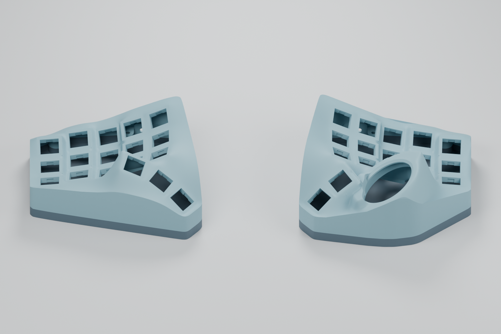

# Gyre Nano · 洄流

**English** | [简体中文](README.zh-CN.md)

A wireless, hot-swap split trackball keyboard enclosure derived from [BastardKB Charybdis Nano](https://github.com/Bastardkb/Charybdis). It keeps the familiar 3×5 keywell and thumb layout while replacing the open frame with a rounded, closed enclosure inspired by Charybdis MK2.

“Gyre / 洄流” echoes the swirling water of Charybdis; Nano denotes the compact layout. This is an independent derivative project.

**Earlier enclosure baseline: right upper V11; left upper and both bottom trays V7.** Current integrated PCB/retainer routes are linked below. Geometry checks and reference-profile slicing have passed. Physical printing and complete assembly validation are pending. Images are model renders.

## Layout and compatibility

- 3×5 main keys per half; three left thumb keys, two right thumb keys and a 34 mm trackball: 35 keys total.
- **Mounting positions and relative axes of the main keys, thumb keys and original trackball seat are preserved.** Baselines are mirrored Skeletyl V4 `case_v4_103.stl` on the left and Charybdis Nano `charybdisnano_v2_v187.stl` on the right. [Verification details](docs/geometry.md)
- The outer skin, thumb/ball transitions, sidewalls and bottom trays are redesigned. Height above the desk is not claimed identical to the original.
- Intended hardware: Amoeba Royale single-switch PCBs, Kailh hot-swap sockets, header-mounted nrfmicro, Elite-C-holder and ZMK.
- Original holder mounting datums, a Type-C opening and bottom screw bosses adjacent to the sidewalls.
- Dedicated battery accommodation and a nice!view window remain planned. Ready-to-flash firmware is not included; the prototype PCB designs are linked below.

## Required prints

Print files are in [`files/`](files/) as **geometry-only 3MF**, in millimetres. Import at **100% scale** using your own printer profile; no printer settings or G-code are embedded. The left case is already mirrored.

| Part | File |
| --- | --- |
| Right upper V11 | [gyre-nano-right-v11.3mf](files/3x5/gyre-nano-right-v11.3mf) |
| Left upper V7 | [gyre-nano-left-v7.3mf](files/3x5/gyre-nano-left-v7.3mf) |
| Right bottom V7 | [gyre-nano-right-bottom-v7.3mf](files/3x5/gyre-nano-right-bottom-v7.3mf) |
| Left bottom V7 | [gyre-nano-left-bottom-v7.3mf](files/3x5/gyre-nano-left-bottom-v7.3mf) |
| Holder / USB fit trial | [right-holder-usb-fit.3mf](files/trials/right-holder-usb-fit.3mf) |
| Ball / thumb fit trial | [right-ball-thumb-fit.3mf](files/trials/right-ball-thumb-fit.3mf) |

Bottom STEP files are also in [`files/3x5/`](files/3x5/), in assembly coordinates; bottom 3MF files use bed coordinates. Upper cases are mesh models, without exact B-rep STEP exports.

Use the original upstream trackball components below. Their final installed positions have been checked for static fit:

| Part | Charybdis file |
| --- | --- |
| Nano adapter top | [`adapter_v2_top_v75.stl`](https://github.com/Bastardkb/Charybdis/blob/47af70b9cd9b8d1d3a055ea88ab95c724bd3c02a/files/3x5%20nano/adapter_v2_top_v75.stl) |
| BTU adapter bottom | [`adapter_btu_bottom_v32.stl`](https://github.com/Bastardkb/Charybdis/blob/47af70b9cd9b8d1d3a055ea88ab95c724bd3c02a/files/mods/btu/adapter_btu_bottom_v32.stl) |
| Sensor cover | [`sensor_cover_v51.stl`](https://github.com/Bastardkb/Charybdis/blob/47af70b9cd9b8d1d3a055ea88ab95c724bd3c02a/files/sensor_cover_v51.stl) |

## FDM printing and assembly

Print the two trials first to check controller header height, USB access, insert fit and the thin ball-opening skirt. Full cases and trays have passed reference slicing, but the complete adapter installation motion, support removal and manufacturing tolerances still need a physical trial. A local lower edge near the ball opening has a radial material chord of about 0.60 mm and deserves particular attention.

[FDM printing notes](docs/printing.md) · [Geometry checks and limits](docs/geometry.md) · [Build guide (TBD)](docs/build-guide.md)

## Electronics and integrated prints

**Current snapshot: v0.2.0-prototype.1 — waiting for PCB samples and physical assembly.** The earlier enclosure prints above remain available for the existing Amoeba build. The new column-PCB routes use the integrated shells and their matching retainers.

| Route / part | Files |
| --- | --- |
| FR4 keyfield, 0.6 mm, 99.70 × 99.80 mm | [V33 KiCad / EDA / Gerber](pcb/keyfield-fr4/README.md) |
| Retained electrically isolated FR4 alternative | [V32](pcb/keyfield-fr4/alternative-isolated/README.md) |
| FPC keyfield, 0.11 mm, 97.18 × 96.47 mm | [V27 KiCad / sample Gerber](pcb/keyfield-fpc/README.md) |
| Left/right controller holders | [Corrected native EDA projects](pcb/holders/README.md) |
| PMW3610 sensor with FFC | [Corrected native EDA project](pcb/sensor/README.md) |
| Integrated upper shells + FR4 retainers | [STL / STEP](files/integrated-fr4/README.md) |
| Bare-FPC direct supports | [STL / 3MF / STEP](files/fpc-supports/README.md) |

Existing holder interfaces and key/ball mounting poses are retained. Six keyfield FFCs are still required per hand. Cross-region FR4 bridges must be removed before curved installation. Thin-FR4 forming, FPC durability, complete cable paths and printed fit remain trial items. No 0.4 mm thickness change is included.

[Electronics index](pcb/README.md) · [BOM](pcb/keyfield-fpc/BOM.zh-CN.md) · [CSV](pcb/keyfield-fpc/BOM.csv) · [All prints](files/README.md) · [Firmware placeholder](docs/firmware.md)

## Repository layout

| Path | Contents |
| --- | --- |
| `files/` | Print-ready geometry, integrated shells and FR4/FPC retainers |
| `pcb/` | Current KiCad/EDA projects, sample packages, BOM and checks |
| `docs/` | Build/printing notes, images, verification and release records |
| `development/` | Modeling sources, dimensions, reference geometry and engineering tools |

See [development notes](docs/DEVELOPMENT.md) for dependencies and coordinate conventions. Old cross-version pipelines are preserved as a checksummed engineering snapshot attached to the pre-release; disposable exports and local caches are excluded from Git.

## Attribution and license

Mechanical designs derive from [Charybdis](https://github.com/Bastardkb/Charybdis) and [Skeletyl](https://github.com/Bastardkb/Skeletyl) by BastardKB and their original contributors, under **CC BY-NC-SA 4.0**. Changes here include the closed skin, blended transitions, wireless hardware accommodation and matching bottom trays.

[Elite-C-holder](https://github.com/Bastardkb/Elite-C-holder), [Amoeba Royale](https://github.com/mtl/keyboard-pcbs/tree/master/amoeba-royale) and [ZMK](https://github.com/zmkfirmware/zmk) retain their respective authorship and licenses. See [license scope](LICENSE.md) and [source records](docs/ATTRIBUTION.md).
