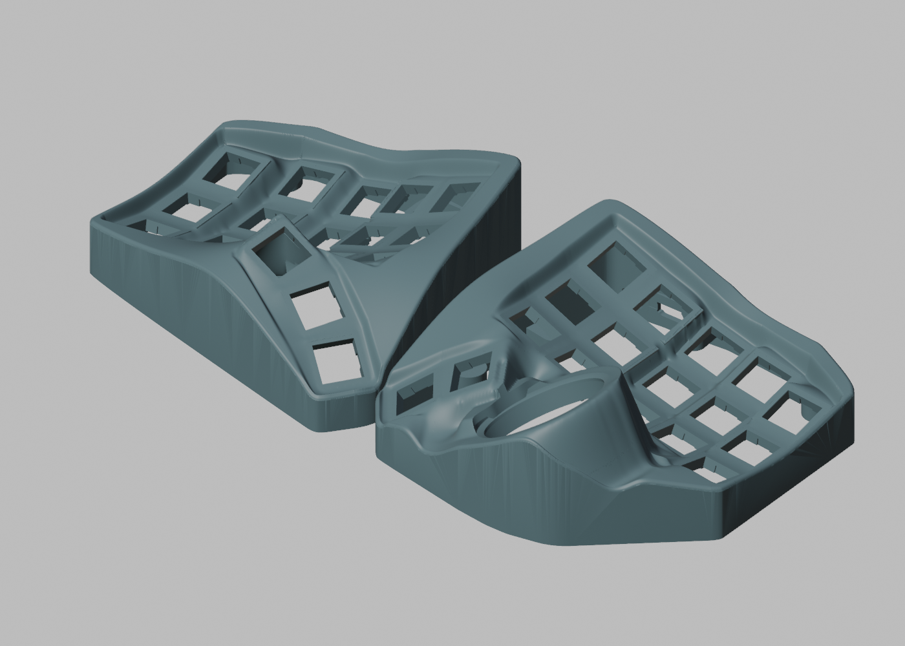

# 洄流 · Gyre Nano

[English](README.md) | **简体中文**

基于 [BastardKB Charybdis Nano](https://github.com/Bastardkb/Charybdis) 的无线、热插拔分体轨迹球键盘外壳项目。保留熟悉的 3×5 键位曲面和拇指键布局，将原来的开放式结构改为圆润的封闭外壳，风格参考 Charybdis MK2。

“洄流 / Gyre”呼应 Charybdis 的漩涡意象，Nano 代表紧凑布局。这是独立派生项目。

**当前外壳试制版：一体式加高肩部，球仓靠主键区的外沿已收圆。** 最新上壳保留原键位、拇指及球座的安装关系，沿用现有底板和 FR4/FPC 承托。几何与装配间隙检查通过；这一版尚未切片或实物试装。图片展示当前模型。

[最新模型与检查记录](models/raised-rim/README.md) · [球仓局部近照](models/raised-rim/right-outer-seam.png) · [俯视图](models/raised-rim/top.png)

## 布局与兼容性

- 每侧 3×5 主键区；左侧 3 个拇指键，右侧 2 个拇指键及 34 mm 轨迹球，共 35 键。
- 主键区、拇指键和原轨迹球座的**安装位置与轴线关系保留**。左右基准分别为镜像 Skeletyl V4 `case_v4_103.stl` 和 Charybdis Nano `charybdisnano_v2_v187.stl`。[校验说明](docs/geometry.md)
- 新外皮、拇指/球口之间的过渡、侧壁和底板是重新设计的；桌面以上高度不承诺与原版一致。
- 当前电路路线使用 FR4 或 FPC 键区、Kailh 热插拔座、通过排针安装的 nrfmicro 和 ZMK。最初原型使用 Amoeba Royale 单轴 PCB 与 Elite-C-holder；新的 holder 及承托设计见下方入口。
- 保留原 holder 安装基准，预留 Type-C 开口；底板螺丝座贴近外壁。
- 电池仓专门优化和 nice!view 开窗待完成；本快照不包含可直接刷写的固件；下方提供当前电路试样工程。

## 所需打印件

打印文件位于 [`models/`](models/)，采用仅含几何的 **3MF**，单位为毫米，以 **100%** 比例导入切片器，不附带打印机配置或 G-code。左壳已镜像，无需再次镜像。

| 零件 | 文件 |
| --- | --- |
| 当前右上壳 | [GyreNanoRightShell.3mf](models/raised-rim/GyreNanoRightShell.3mf) |
| 当前左上壳 | [GyreNanoLeftShell.3mf](models/raised-rim/GyreNanoLeftShell.3mf) |
| 右底板 V7 | [gyre-nano-right-bottom-v7.3mf](models/3x5/gyre-nano-right-bottom-v7.3mf) |
| 左底板 V7 | [gyre-nano-left-bottom-v7.3mf](models/3x5/gyre-nano-left-bottom-v7.3mf) |
| FR4 路线承托 | [主区与拇指承托](models/integrated-fr4/README.md) |
| FPC 路线承托 | [直接承托与间隙小样](models/fpc-supports/README.md) |

底板 STEP 也在 [`models/3x5/`](models/3x5/)，使用装配坐标；底板 3MF 使用贴床坐标。上壳目前提供网格模型，没有精确 B-rep STEP。

按 PCB 路线选择一套承托。[V11/V7 基础外壳](models/3x5/)及 [V14 整合上壳](models/integrated-fr4/README.md)仍保留供对照。当前 3MF 与已校验 STL 的坐标、三角面完全一致；体积较大的 ASCII STL 查看副本保留在本地，不纳入 Git。

轨迹球组件使用上游原件，以下版本已检查最终安装位置的静态配合：

| 零件 | Charybdis 文件 |
| --- | --- |
| Nano adapter 上件 | [`adapter_v2_top_v75.stl`](https://github.com/Bastardkb/Charybdis/blob/47af70b9cd9b8d1d3a055ea88ab95c724bd3c02a/files/3x5%20nano/adapter_v2_top_v75.stl) |
| BTU adapter 下件 | [`adapter_btu_bottom_v32.stl`](https://github.com/Bastardkb/Charybdis/blob/47af70b9cd9b8d1d3a055ea88ab95c724bd3c02a/files/mods/btu/adapter_btu_bottom_v32.stl) |
| 传感器盖 | [`sensor_cover_v51.stl`](https://github.com/Bastardkb/Charybdis/blob/47af70b9cd9b8d1d3a055ea88ab95c724bd3c02a/files/sensor_cover_v51.stl) |

## FDM 打印与装配

计划使用创想三维 K1C、0.4 mm 喷嘴及 PLA/PETG，当前模型请自行切片。先试打所选 PCB 路线的承托间隙小样；[早期 holder/USB、球口/拇指小样](models/trials/)可检查继承的接口，但不代表新版肩部和球仓外形。键帽全行程、工具空间、adapter 装入动作、拆支撑和制造公差仍需实物验证。球口继承的局部薄处见[当前检查说明](models/raised-rim/README.md)。

[FDM 打印说明](docs/FDM-PRINTING.md) · [几何验证与限制](docs/geometry.md) · [装配指南（待补充）](docs/build-guide.md)

## 电路与整合打印件

**电路基线：v0.2.0-prototype.1，等待 PCB 到货和实物装配验证。** 此次外壳更新没有改动 PCB。两种列板路线均可使用最新上壳及对应承托；早期发布附件仍保留当时的模型。

| 部件／路线 | 文件入口 |
| --- | --- |
| 0.6 mm FR4 键区，99.70 × 99.80 mm | [V33 KiCad / EDA / Gerber](pcb/keyfield-fr4/README.zh-CN.md) |
| 独立区域 FR4 备选 | [V32](pcb/keyfield-fr4/alternative-isolated/README.md) |
| 0.11 mm FPC 键区，97.18 × 96.47 mm | [V27 KiCad / 试样包](pcb/keyfield-fpc/README.zh-CN.md) |
| 左右主控 holder | [已修正阻焊的 EDA 工程](pcb/holders/README.md) |
| PMW3610 插座 sensor | [已修正的 EDA 工程](pcb/sensor/README.md) |
| 当前上壳 | [3MF / 预览 / 检查记录](models/raised-rim/README.md) |
| 配套 FR4 承托及 V14 参考上壳 | [STL / STEP](models/integrated-fr4/README.md) |
| FPC 直接承托 | [STL / 3MF / STEP](models/fpc-supports/README.md) |

保留原键位、拇指、轨迹球安装基准及已打板 holder 接口；每侧仍用六根键区 FFC。FR4 跨区域桥必须在曲面安装前剪掉。薄板折弯、焊接、排线和打印配合待试装；当前没有应用 0.4 mm 改型。

[电路总览](pcb/README.zh-CN.md) · [采购 BOM](pcb/keyfield-fpc/BOM.zh-CN.md) · [CSV](pcb/keyfield-fpc/BOM.csv) · [全部打印件](models/README.md)

## 仓库结构

| 路径 | 内容 |
| --- | --- |
| `models/` | 打印模型、整合上壳与 FR4/FPC 承托 |
| `pcb/` | 当前 KiCad/EDA 工程、打样包、BOM 与检查记录 |
| `docs/` | 装配与打印说明、图片、验证及发布记录 |
| `development/` | 建模源码、参数、参考模型和工程工具 |

重建依赖和坐标约定见 [开发说明](docs/DEVELOPMENT.md)。旧版跨版本脚本与依赖已封存为预发布附件中的工程快照；重复导出和临时日志已清理，缓存不纳入 Git。

## 来源与许可

机械设计派生自 BastardKB 及原作者的 [Charybdis](https://github.com/Bastardkb/Charybdis) 和 [Skeletyl](https://github.com/Bastardkb/Skeletyl)，沿用 **CC BY-NC-SA 4.0**。本项目的修改包括封闭外皮、过渡曲面、无线硬件安装结构和配套底板。

[Elite-C-holder](https://github.com/Bastardkb/Elite-C-holder)、[Amoeba Royale](https://github.com/mtl/keyboard-pcbs/tree/master/amoeba-royale) 和 [ZMK](https://github.com/zmkfirmware/zmk) 保留各自作者归属及许可。详见 [许可范围](LICENSE.md) 和 [来源记录](docs/ATTRIBUTION.md)。
