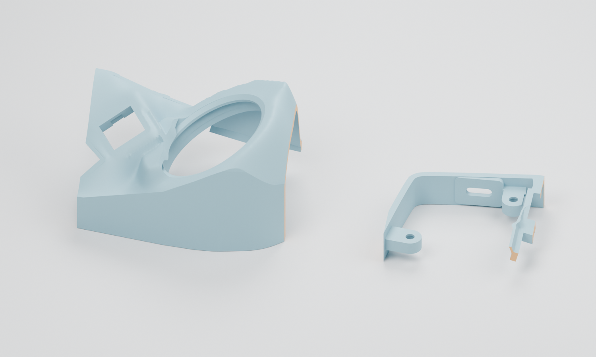

# 洄流 · Gyre Nano：FDM 试打印与模型优化评估

当前判断：**先做局部试打印，不需要为了 FDM 改动整套键位曲面。** 主体和底板已正常切片，最值得关注的是新增球口薄边、支撑拆除及真实安装公差。当前是 V11 几何的打印准备，不是宣称已经实物定型的 V12。

## 已做的检查

四个完整零件和两块小样均为单一闭合实体，法向一致。小样裁切后仅以 0.0000001 mm 容差消除数值退化三角面，另用布尔体积差确认新增/移除材料均小于 0.0001 mm³；主模型未修改。holder 小样中两片与安装座无关的裁切残片被排除，原安装座功能区域保留。

参考检查使用 Bambu Studio 02.09.01.70、A1 0.4 mm / Generic PLA 配置；这不是已确认的实际设备或材料。六件原 STL 和发布的六件 3MF 均成功生成刀路，进程正常退出，见 [3MF 切片摘要](verification/public-model-slicing.json)。估时仅用于比较试打成本。

公开打印文件采用仅含几何的 3MF，所有顶点坐标和三角面索引经回读验证与原 STL 完全相同；简单 float32 二进制 STL 转换可能使近重合网格退化，因此未采用。原始工作 STL 仍保存在本地。文件哈希见 [manifest](../files/manifest.json)。

## 优先试打两个小样

左侧为球口/拇指小样，右侧为 holder/USB 小样；橙色是裁切面，不是新增材料。小样保持原打印朝向，仅平移至打印坐标。裁切改变了整体刚度和支撑路径，不能代替完整外壳的强度与安装顺序验证。

| 顺序 | 文件 | 尺寸（mm） | Classic 参考估时/用料 | 核对事项 |
| --- | --- | --- | --- | --- |
| 1 | [holder / USB 小样](../files/trials/right-holder-usb-fit.3mf) | 54 × 45.96 × 13 | 约 19 分钟 / 5.42 g | holder 原孔距、排针架高后的主控、实际 USB 插头、嵌件孔适配及拆支撑空间 |
| 2 | [球口 / 拇指小样](../files/trials/right-ball-thumb-fit.3mf) | 77 × 59.25 × 47.52 | 约 1 小时 56 分钟 / 30.63 g | 薄边能否连续成形且不被拆支撑扯坏、原 adapter 静态配合、34 mm 球、邻近轴和 PCB |

小样与整壳应使用同一材料、喷嘴和主要工艺参数。先检查成形和去支撑后的完整性，再装配。球口试件侧面被裁开，adapter 在小样中容易装入不代表完整封闭壳也能按同一路径装入。

## 初始切片设置

以下是本次成功离线检查使用的参数，不是所有打印机的通用参数。温度、流量和速度使用实际打印机/材料的校准配置。

| 项目 | 评估起点 |
| --- | --- |
| 喷嘴、层高 | 0.4 mm / 0.20 mm；首层也为 0.20 mm |
| 缩放与摆放 | 100%，现有 Z=0 底边贴床，键位朝上；底板以完整平底贴床 |
| 壁数、填充 | 3 壁、15% 填充；薄处能容纳几条线仍由实际几何决定 |
| 上壳/小样支撑 | 自动树状，允许支撑从模型上生成；检查接触处和拆除路线 |
| 底板支撑 | 关闭；该朝向的几何检查没有发现离床的陡峭朝下表面 |
| 支撑间隙 | 本次参考 Z 间隙 0.2 mm、XY 间隙 0.35 mm；按材料和试件效果调整 |
| 首层扩张补偿 | 参考值 0.075 mm，需按自己的设备试配；不改全局模型比例 |

Classic 基线六件均切片成功。Arachne 可变线宽对右壳及两个小样另作对照，本地工程记录中保留了该对照结果。Arachne 能按局部厚度调整挤出宽度，但不能把过薄或受力不足的材料变成可靠结构。[Prusa 官方 Arachne 说明](https://help.prusa3d.com/article/arachne-perimeter-generator_352769)

## 哪些地方可能需要模型优化

| 区域 | 当前证据 | 下一步决定依据 |
| --- | --- | --- |
| 球口短隔壁下缘 | 中心方向径向材料弦长由约 0.596 mm 增至 1.640 mm；最下缘不足两条常规线宽。这不是全壳最小法向壁厚测量 | 若线条缺失、拆支撑易损或轻触开裂，优先局部加厚/调整下缘或可拆支撑，重跑球通道、PCB 与 adapter 校验 |
| 主体侧壁、底板 | 侧壁设计内偏置约 2.4 mm，底板平底厚 2.0 mm、总高 7.3 mm；两底板切片无须支撑 | 先试现有厚度；不整体加厚或抬高，以免挤压电子元件和改变使用高度 |
| holder、USB 和嵌件孔 | 几何孔位基准保持，但实际嵌件型号、打印收缩和排针高度未验证 | 先用短小样确认；需要时只改相应孔的补偿/引导倒角，不统一扩大轴孔 |
| 轴框卡扣和曲面 | 原版功能面保留；支撑接触面可能粗糙 | 先控制支撑接触和拆除方式。不要用全局平滑把卡扣、键位承托面一起磨掉 |
| 大平底首层 | 贴床区域可能产生扩张，材质也可能翘曲 | 用底板及小样检查边缘，再决定局部导入倒角或首层补偿 |

Prusa 的建模建议指出，0.4 mm 喷嘴的常见挤出线宽约为 0.45 mm，配合间隙和下悬表面应结合设备与材料验证；朝下的圆角还可能产生更陡悬垂。[官方 FDM 建模建议](https://help.prusa3d.com/article/modeling-with-3d-printing-in-mind_164135)

## 完整壳体参考成本

Classic 参考切片：左上壳约 4 小时 54 分钟 / 81.85 g；右上壳约 5 小时 21 分钟 / 91.43 g；左底板约 54 分钟 / 34.41 g；右底板约 58 分钟 / 37.76 g。数字包括此参考支撑策略的影响，不保证实际打印时间或用料。

打印机型号、喷嘴、材料和嵌件型号确定后，再据小样决定最终工艺和必要的局部几何修订。工程基线仍是 V11；34 mm 球沿原倾斜轴线的模型间隙约 0.65 mm，指定组件静态无新增干涉，实际 adapter 装入动作与整机走线仍待验证。交付包不含机器专用 G-code。
