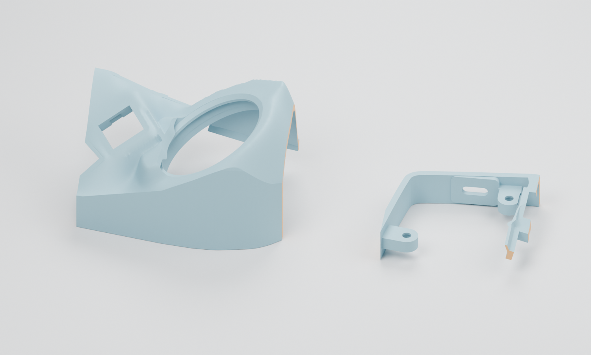

# FDM printing notes

[中文](FDM-PRINTING.md)

Start with the [two fit trials](../files/trials/) before printing the complete
enclosure. Current meshes are closed, consistently wound single components.
The 3MF files preserve every vertex coordinate and triangle index from the
working STL meshes; no global smoothing, resizing or hole enlargement was applied
for publication. [File manifest](../files/manifest.json)

The left sample in the image covers the ball/thumb region; the right sample
covers the holder and USB opening. Orange faces are crop boundaries. Cropping
changes stiffness and support access; trial fit does not prove the full adapter
can be inserted into the closed case.

| Trial | Size (mm) | Check |
| --- | --- | --- |
| Holder / USB | 54 × 45.96 × 13 | Original mounting spacing, controller/header height, USB plug, inserts and support removal |
| Ball / thumb | 77 × 59.25 × 47.52 | Thin skirt, specified adapter, 34 mm ball, nearby switch and PCB |

## Reference slicing setup

The reference used Bambu Studio 02.09.01.70, an A1 0.4 mm profile and Generic PLA.
This is a comparison profile, **not a confirmed printer/material selection**.
Use calibrated temperature, flow and speed settings for your own equipment.

| Setting | Reference |
| --- | --- |
| Nozzle / layer height | 0.4 / 0.20 mm |
| Scale / orientation | 100%; flat Z=0 bottom on bed; key openings face up |
| Walls / infill | 3 / 15% |
| Upper and trial support | Automatic tree support; allow support on the model |
| Bottom-tray support | Off |
| Support Z / XY separation | 0.20 / 0.35 mm |
| Elephant-foot compensation | 0.075 mm; confirm with a fit trial |

Classic slicing passed for all six working STL models. Arachne was also checked
for the right upper and both trials. Public 3MF slicing results are recorded in
[the verification summary](verification/public-model-slicing.json).
No machine-specific G-code is distributed.

## Fit and strength checks before committing to a full build

- The ball-opening skirt's lower edge has a radial material chord of about
  **0.596 mm**, increasing to about 1.640 mm higher up. This is a local radial
  measurement, not a global minimum normal wall thickness. Check that lines form
  continuously and survive support removal; local thickening may be needed.
- Nominal sidewall inset is about 2.4 mm. The bottom's flat floor is 2.0 mm, with
  a total tray height of 7.3 mm. Print the tray on its flat underside.
- Verify insert specifications, shrinkage and USB/header height on the holder
  sample. Do not compensate by scaling the whole case or enlarging all switch holes.
- Keep support contact away from functional key lands where possible and inspect
  removal access in the slicer.
- The 34 mm ball's insertion clearance is checked geometrically. Complete adapter
  insertion, wiring, battery space and assembled fit remain unverified.

See [geometry scope](geometry.md). Reference guidance:
[Prusa FDM modeling](https://help.prusa3d.com/article/modeling-with-3d-printing-in-mind_164135)
and [Arachne](https://help.prusa3d.com/article/arachne-perimeter-generator_352769).
