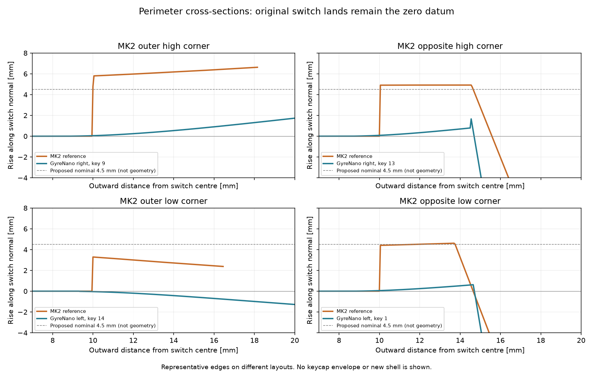

# Raised perimeter study / 键区围边评估

Status: study followed by a candidate implementation, 2026-11-13.
**[Candidate models and checks](../models/raised-rim/README.md) are now available.**
The V14 baseline and previously published print files remain unchanged.
Reference: upstream `Charybdis/files/4x6/MK2/charybdis_v4_247_right.stl`.
Current baseline: both upper shells in [models/integrated-fr4](../models/integrated-fr4/).

The MK2-style recessed appearance can be pursued by adding a raised perimeter
across the complete exterior shoulder outside the fixed switch lands. Moving or scaling the switch array, thumb cluster
or trackball mount is unnecessary. This is a construction strategy, not a
completed universal keycap-fit certification. The candidate now has exported-mesh
mounting, support, generic cap-envelope and trackball-clearance checks.

## 实测结果

已读取 MK2 右壳及 GyreNano 当前左右上壳。MK2 中识别到 27 个具有四角
13.9 mm 方孔边界的安装平面，用其中四个外围键位作代表截面。

测量以每个轴体的安装面为零点，沿该轴体法向计算高度；**不是整个键盘的全局 Z 高度**。
以下取沿键位边方向、距轴心 12 mm 的点：

| 代表截面 | MK2 壳面高出安装面 |
| --- | ---: |
| 外围高位角 | 5.98 mm |
| 对侧高位角 | 4.92 mm |
| 外围低位角 | 3.00 mm |
| 对侧低位角 | 4.51 mm |

MK2 在这些方向约距轴心 10 mm 处出现明显台阶。当前 GyreNano 的四个外围
比较截面在距轴心 12 mm 处为 −0.19～+0.34 mm，没有相同的遮挡高度。
两种布局不同，这些是局部坐标下的代表性比较，不是对应键位的配准，也不是全周最大／最小值。



[完整采样、基线 SHA256 和测量方式](verification/mk2-rim-study.json)。
图中的 4.5 mm 虚线是拟议参数，不是已生成模型的表面。

## 建议设计

- 以 **4.5 mm 法向高度差**作为外围围边的初始目标，参考 MK2 的高低变化调整，
  不将所有边缘抬到同一世界高度，也不把 3～6 mm 当作所有区域的强制范围。
- 加高整个外壳肩部，一直延伸到原侧壁；内侧向键区形成落差，外侧顶角圆润过渡。
  已取消上一版抬高条带外侧向旧顶面回落的做法，避免形成栅栏和沟槽。
  不逐个轴孔增加高圈，也不把键间薄桥整体加高。
- 拇指外周采用较低、逐渐收尾的围边；拇指到主区及球仓交界处不强行维持
  4.5 mm，优先消除尖峰、避免妨碍手指侧向移动及球的操作。
- 用户当前使用 XDA，但**造型高度以 MK2 为参考，不按 XDA 外形定制**。
  工程上仍须检验键帽全行程、侧向余量和拔轴工具空间。设计不与某一键帽绑定，
  并不等于可以承诺兼容所有键帽；尚未测定最终通用避让包络。
- 保留现有底板、承托、PCB 及 holder 安装关系，优先在原外轮廓内增加上沿。
  若某处容不下圆角和避让，先降低或收短该段围边，不默认扩大整壳。

## 后续模型修改的固定约束

1. 原样保留 35 个轴孔、卡扣／承托面、中心位置和轴向，锁定主键及拇指间的全部相对位置。
2. 原样保留右侧 adapter 安装基准、球座核心及其对各键位的位置；不通过移动轨迹球腾空间。
3. 复用并重跑 34 mm 球及 35.2 mm 插入通道、adapter／BTU／sensor cover 的现有几何检查。
4. 检查新增围边与键帽运动及拆装空间；检查新增几何不侵入主控、PCB、承托及螺丝区域。
5. 对最终 STL 重新测量轴孔中心、安装面、轴向和球座；布尔差集核对固定功能区域无变化，
   并检查封闭性、孤立体、局部薄壁和尖峰。效果图不能替代这些检查。

后续已按此方案生成两侧独立候选及对比预览，见 [候选模型](../models/raised-rim/README.md)。
用户进一步指出需要减少多余的造型曲面，因此已改为整体拟合肩部，取消旧顶面下限及分区限高。
允许削低非功能旧外表面；右侧非功能内顶面随外形调整并检查壁厚与装配干涉。
固定的键位、拇指和球座安装关系继续独立回归。截面与局部放大图见候选模型目录。拔轴工具、具体键帽与手指活动仍待实物检查。
原打印文件、打样文件和已发布版本保持原字节。

## Reproduce

From the repository root:

```sh
bash development/scripts/run_python.sh checks/assess_mk2_rim.py
```

This uses the existing mesh-analysis environment, writes the report and section
plot, and verifies that all three input STL hashes are unchanged. It does not
generate a revised shell or run a slicer.


### Outer seam correction

The raised shoulder now rebuilds its outer1.5mm band with a periodic perimeter
height guide, removing the grid-aligned roof/sidewall staircase while keeping
the broad fair surface. Functional key/ball and clearance guards are reapplied.
Both sides pass the original pose/fit checks; additional exported-edge sampling
and USB-opening checks are recorded in
[outer-seam.json](../models/raised-rim/outer-seam.json), with a
[close view](../models/raised-rim/right-outer-seam.png).
Fine sidewall tessellation remains visible with flat face normals; this is not
a global smoothness or physical print-quality certification.


### Rounded ball-collar lobe

The forward ball-collar lobe is refitted toward a27.5mm concentric exterior arc,
referencing the4×6 MK2 appearance. A radial map with matched return derivative
blends down into the body, preserving radius23.5mm and below, key/PCB prisms,
and the lower10mm interface. The supplied ball adapter interfaces are verified
separately rather than preserving the old decorative core outline wholesale.
[Circle/wall audit](../models/raised-rim/ball-collar.json) and
[face-on preview](../models/raised-rim/right-ball-collar.png) describe the measured
forward arc and its limits. The left shell is unchanged by this correction.
