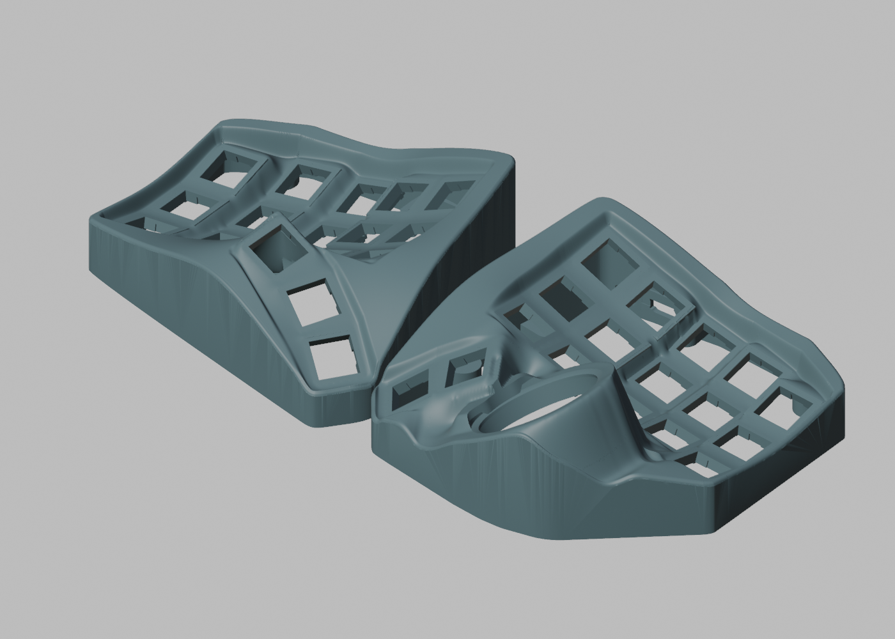
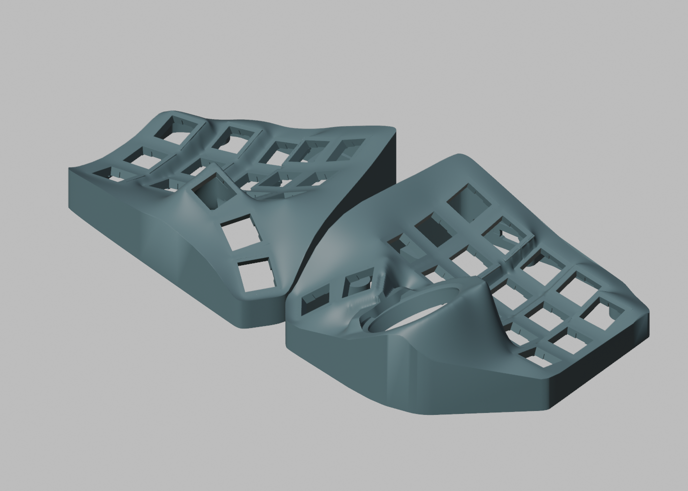

# Integrated raised-shoulder shells / 一体式加高肩部候选上壳

Candidate, revised 2026-11-13. The whole exterior shoulder rises around the
unchanged keywell to hide part of the switch housings, inspired by Charybdis
4×6 MK2. The shoulder extends directly to the outside wall; it does not fall
back to the old roof outside a raised strip. This replaces the rejected
fence-like candidate in this directory. **No keys, thumb
cluster or trackball mount have been repositioned.** Physical assembly is pending.

| Part | Geometry-only model |
| --- | --- |
| Left upper shell | [GyreNanoLeftShell.3mf](GyreNanoLeftShell.3mf) |
| Right upper shell | [GyreNanoRightShell.3mf](GyreNanoRightShell.3mf) |

Local STL viewing copies: `GyreNanoLeftShell.stl` and `GyreNanoRightShell.stl`.
These are byte-identical copies of the verified ASCII STL exports, kept locally
and ignored by Git because each exceeds 100 MB. Preview images are available
below without a 3D viewer.

Millimetres, 100% scale, original assembly coordinates. These 3MFs contain no
printer settings or G-code. They preserve every vertex coordinate and triangle
of the checked STL exports exactly; no slicing was performed. Choose orientation
and supports in your slicer. Intended trial equipment: K1C, 0.4 mm nozzle, PLA/PETG.

Reuse the existing [V7 bottom trays](../3x5/), and choose either the
[0.6 mm FR4 retainers](../integrated-fr4/README.md) or
[bare-FPC supports](../fpc-supports/README.md). Mount positions and the outer XY
bounds are unchanged. Do not print both support sets for one build.

## Appearance

After:



Before:



[Top view](top.png) · [Left transition detail](left-transition-detail.png) ·
[Right transition detail](right-transition-detail.png) ·
[Repaired outside seam beside the ball cup](right-outer-seam.png) ·
[Round ball-collar view](right-ball-collar.png).
Renders use flat triangle normals to show actual mesh facets without smooth
normal interpolation. They show appearance only; geometry checks are separate.

The outer shoulder is now refitted as a broad fair surface using key-plane
height and slope guides. It no longer follows the old roof as a lower bound,
nor switches between separate main/thumb height ceilings. The right side uses
a virtual continuation of the left high-thumb guide (not an extra key), with
a fixed preserved band around the installed ball collar (12.5 mm outside the
reference outline in XY). The functional ball surfaces stay fixed. The outermost1.5mm shoulder/sidewall
seam is rebuilt; a subsequent local refit rounds the nonfunctional forward
ball collar within this band. Narrow transitions remain
only where this body meets the unchanged functional keywell and ball geometry.

[Six exported-mesh sections](transition-sections.png) and their
[raw samples/hashes](transition-sections.json) compare the earlier rejected
integrated shoulder with this revision. Other sections include unchanged key
geometry and silhouette edges; these samples do not prove global smoothness.
Existing sharp switch aperture/land edges are intentionally retained.

The roof/sidewall seam is rebuilt within a1.5mm-wide perimeter band using a
periodic height guide sampled0.15mm along the contour and smoothed over0.65mm.
The outer0.55mm no longer follows the stair-stepped old intersection; the band
blends back into the existing broad shoulder and retains a1.5mm edge radius.
[Actual exported-edge profiles](outer-seam.png) and [raw evidence](outer-seam.json)
compare the previous candidate with this correction. At0.1mm spacing,0.03mm
inside the outline, right-side height jumps above0.5mm fall from16 to0;
the maximum adjacent height difference falls from2.234 to0.267mm. Left has0
such jumps before and after. These are sampled edge diagnostics, not a claim
that every mesh facet or sharp functional edge is smooth. Flat-normal previews
still show fine tessellation on some sidewalls.

USB-window ray profiles were compared with the immutable baseline at2535 rays
per half; opening/hit counts match. The lower8mm interface and USB region have
no material change above0.001mm³ compared with the pre-repair candidate.

## Rounded forward ball collar

The forward decorative lobe now follows a concentric circular-arc guide in the
unchanged ball-seat frame, visually referenced to Charybdis4×6 MK2. The target
outer radius is27.5mm; this dimension is the shell exterior, not the34mm ball.
The change continues down the outside wall and blends back into the body.
A derivative-matched radial return avoids a crease at the guide radius.
Radius23.5mm and below, key/PCB prisms, and the lower10mm interface stay fixed.
Long legacy triangles are refined before the local deformation; there is no
global scaling or key/ball repositioning.

[Before](right-ball-collar-before.png) · [After](right-ball-collar.png) ·
[Exported-mesh circularity and wall probes](ball-collar.json).
The measured forward arc at ball-local height−0.25mm, angles0–95°, now has
radius27.441–27.622mm, versus27.489–34.131mm before. Transitions into the thumb
and key regions are retained; this does not make the entire shell a circle.
1497 radial material intervals pass a baseline-aware1.6mm check. Of these,
1492 had baseline width≥1.6mm and remain≥3.778mm; five inherited short intervals
are recorded separately. These sampled intervals are not a whole-shell minimum
wall certificate. The deformation's sampled radial derivative remains positive.

## Dimensions and verification

- The fit uses **4.5 mm main-key / 1.8 mm thumb** normal-offset guides plus
  local slope samples. These are fitting inputs, not a constant height offset
  or a ceiling on added material. The former 6/2.2 mm vertical caps are removed.
- The exterior footprint remains fixed. Outer top radius is up to 1.5 mm;
  the keywell attachment transition is 2.8 mm. Nonfunctional old roof material
  is lowered where needed to remove redundant humps; the right nonfunctional inner roof is rebuilt beneath the exterior. Existing
  hardware is checked for added overlap; functional mounting surfaces stay fixed.
- Both exported shells are closed, consistently oriented single components.
  Left sampled inner roof exits agree with V14 within 0.001 mm. Right inner
  roof positions may change; their clearance is checked against installed parts.
  Current-inner-normal roof probes require at least 1.6 mm, or the baseline
  minimum where it was already thinner. Probe counts and minima are recorded in verification.json. This is sampled,
  not whole-shell certification.
- All **35** switch apertures and bearing planes were remeasured against the
  upstream Nano/Skeletyl meshes. Maximum key-centre residual: **0.00000123 mm**;
  maximum pairwise-vector residual: **0.00000173 mm**. These are numerical
  comparison residuals, not achievable print tolerances.
- Ball-seat probe changes from V14 are below **0.000006 mm** after bounded
  mesh cleanup. Fitted seat-centre residual
  versus upstream: **0.00000009 mm**. Ball-seat-to-key vector residual:
  **0.00000109 mm**. The sphere centre depends on the installed adapter/bearings.
- **35.2 mm continuous ball-insertion capsule: no overlap**. A 34 mm ball retains
  **0.649 mm minimum radial margin** to the shell along the tested axis.
- No added overlap with the supplied top adapter, BTU bottom, sensor cover,
  either FR4 retainer set, or the FPC supports restored to assembly coordinates.
- No added overlap with a **19.2 × 19.2 mm square cap envelope**, extending from
  +0.2 to +20 mm along each switch axis. This is a generic design envelope,
  **not** a measured XDA model or a universal keycap/puller/finger fit guarantee.

The reference V14 ball wall has a maximum **0.00584 mm** ray-sample difference
from the upstream mesh at depth −2 mm; this difference is inherited and is
retained within0.000006mm after the perimeter/collar mesh cleanup. Seat fitting and the other mounting
measurements are reported independently rather than calling all surface samples
identical to upstream.

[Verification](verification.json) · [Build parameters](build.json) ·
[3MF hashes and exact round-trip checks](manifest.json) ·
[MK2 section study](../../docs/raised-rim.md)

## 中文

这版将键区外侧的整个壳体肩部抬高，并直接延伸至原侧壁；仅在键区内侧保留落差。
已替换上一版外侧回落、看起来像栅栏的候选设计。轴孔、键位曲面、拇指及球座位置保持原有关系。
主区参考 MK2 采用约 4.5 mm 的局部目标高度差；拇指肩部较低，在球仓附近平缓收尾。
本次重建了外侧肩部的整体形状，不再沿旧顶面分别补高、限高；非功能区的旧鼓包
可以削低，使主区到拇指区形成更直接的坡面。右侧使用对应的外形引导点延续同一造型，
并在球仓边缘保持安装基准。右侧非功能内顶面随外形调整以保证厚度，再检查与 PCB、holder 和承托的干涉；
功能面和轴孔位置保持固定。
原上壳保留在 `integrated-fr4/`，底板与两种承托继续沿用。

球仓靠主键区的凸瓣已按同心圆弧收圆，并向下接回外壁。修整段的外沿半径约
27.44–27.62 mm（这是外壳半径，不是轨迹球半径）；内圈承托、球座及键位保持原基准。
壁厚采样、34 mm 放球通道和既有装配检查通过，仍待实物装配验证。
本次另将顶面与侧壁交界的外缘 1.5 mm 窄带重新生成，移除旧网格裁切留下的阶梯。
沿两侧整圈外缘采样复核，右侧超过 0.5 mm 的相邻高度跳变从 16 处降至 0 处。
保留原有整体坡面；细小三角面纹理在平面法线预览中仍可能可见。
左右模型已通过封闭性、35 键安装几何、球座、放球通道及承托新增干涉检查；
Type-C 开口及底部接口也已复核。
键帽使用通用包络检查，没有按 XDA 外形定制。仍需实际验证按到底、拔键／拔轴工具空间、
手指侧向活动、打印质量与装配间隙。本目录为候选件，尚未经过实物定型。

## Rebuild

From the repository root:

```sh
bash development/scripts/run_python.sh src/raised_rim.py
bash development/scripts/run_python.sh checks/verify_raised_rim.py
bash development/scripts/run_python.sh checks/inspect_shoulder_sections.py
bash development/scripts/run_python.sh checks/inspect_outer_seam.py
bash development/scripts/run_python.sh checks/verify_ball_collar.py
```

The generator uses the immutable V14 STLs and tracked roof fields/assembly
datums, with the established Manifold mesh pipeline. Only sub-micrometre vertex
welding is used to normalize coincident Boolean seams. Opposite coincident
facets cancel after welding, preventing zero-thickness fins. Numerical sheet remnants with absolute volume below 0.000000001 mm³
are removed only after checking their smallest spatial dimension is
below 0.0000001 mm. Redundant
near-collinear facets (altitude below 0.0000001 mm) are removed only when their edge
multiplicities identify extra facets; volume change is below 0.000001 mm³.
Roof attachment extends deeper inside the existing outermost wall to avoid
closed seam voids; disconnected surfaces are rejected.
Section-outline cleanup is bounded by 0.001 mm, with unchanged XY extrema.
Coplanar mesh simplification is bounded by 0.00001 mm; functional measurements
are checked after this cleanup. No unit conversion or global scaling is applied. Working ASCII STLs are under
`development/exports/raised-rim/` and are not tracked because each exceeds 100 MB.
The much smaller checked 3MF files preserve the same mesh exactly.

`development/scripts/export_raised_rim.py` packages the checked geometry and
copies the overview and detail previews from `development/previews/raised-rim/`. Preview
regeneration uses `development/scripts/render_raised_rim.py` in a dedicated empty
scene through the Blender backend; preview files are not geometric evidence.

Derived from BastardKB Charybdis / Skeletyl; the repository's
[CC BY-NC-SA 4.0 licensing and attribution](../../LICENSE.md) continue to apply.
