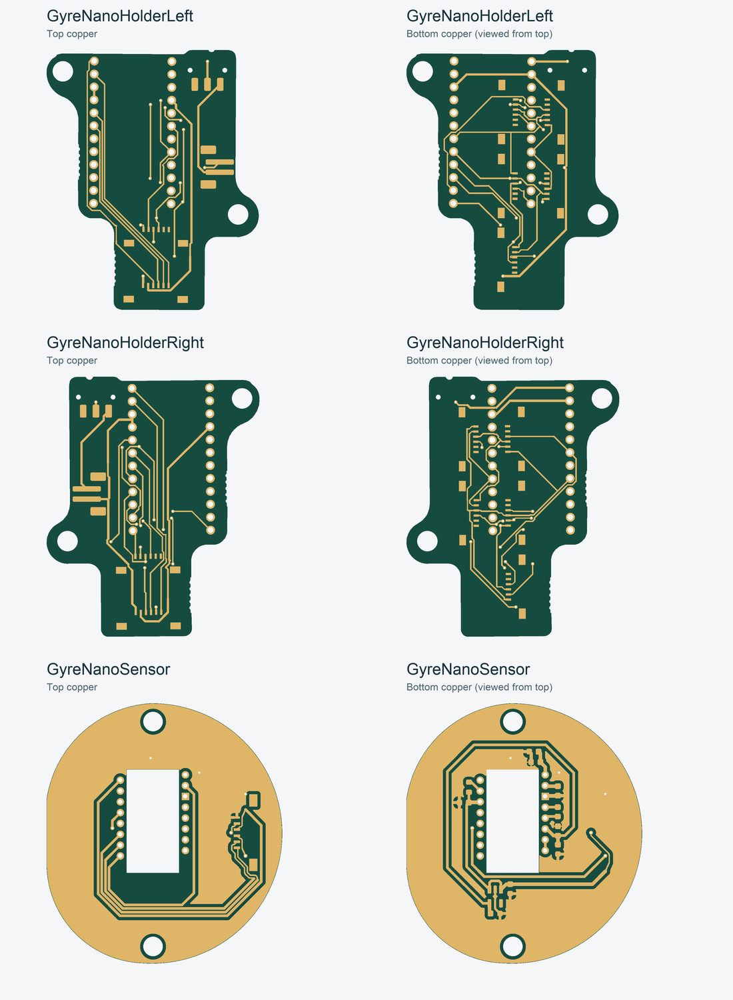

# GyreNano — EDA projects V22

[简体中文](README.zh-CN.md)

Three editable **JLCEDA Pro** projects rebuilt from the existing holder V12 and sensor V5 designs. The KiCad sources and V20 sample exports are retained unchanged. These are reconstructed circuits with project-local symbols, devices and footprints, not imported Gerber drawings.

Open the `.eprj3` entry in the desktop client; keep its surrounding folder intact. Tested with **4.1.99.7adca3d2**.

| Project | Open | Components | FFC sockets | Board thickness |
|---|---|---:|---:|---:|
| Left holder | [GyreNanoHolderLeft.eprj3](../holders/eda/GyreNanoHolderLeft/GyreNanoHolderLeft.eprj3) | 12 | 7 | 1.6 mm |
| Right holder | [GyreNanoHolderRight.eprj3](../holders/eda/GyreNanoHolderRight/GyreNanoHolderRight.eprj3) | 12 | 7 | 1.6 mm |
| PMW3610 sensor | [GyreNanoSensor.eprj3](../sensor/eda/GyreNanoSensor/GyreNanoSensor.eprj3) | 15 | 1 | 1.29 mm source stack* |

*The sensor preserves its 1.2 mm core + copper/mask source stack. This is not a confirmed finished-thickness order specification. No blanket change to 1 mm was made.

## Preserved and changed

- All component/pad positions, rotations and copper sides, controller headers, seven holder FFC interfaces, battery connector and power switch are preserved. Holder mounting holes, sensor mounting holes, optical window and board profiles are unchanged.
- Schematic pin numbers and connections are rebuilt from native KiCad netlists. Intentionally unused pins have explicit no-connect marks. The original routing is retained; the sensor's two ground pours are regenerated by EDA.
- **Solderability correction:** the source holder controller PTH pads and sensor U2 PTH pads omitted solder-mask layers. V22 explicitly opens both sides of these pads. No original mask opening is lost. The original KiCad boards were not modified.
- Sensor mounting holes now have **0.508 mm ground-copper clearance**. This accounts for approximately 11.73 mm² less copper on each side. Small remaining differences come from EDA's thermal/refill geometry (under 0.12 mm² per side beyond the audit tolerance); connectivity remains verified.
- Custom pad libraries are embedded. Schematic symbols use labeled pin blocks; they are editable and electrically linked. Existing fabrication/silkscreen reference graphics are board-level geometry: if changing component placement later, update those graphics as well. Manufacturer procurement IDs and 3D component models were not added.

## Verification

[Validation](checks/validation.json), [save/reopen check](checks/reopen.json), and the three `checks/*-review.json` files record the actual results:

- Native EDA schematic DRC and PCB DRC: **0 findings on all three boards**, including schematic/PCB synchronization. No findings were suppressed.
- **71 / 71 / 47** schematic pin-net entries agree with the source; PCB connectivity agrees as well. Synchronization did not move any component or change its footprint/layer.
- PTH counts including vias: **40 / 40 / 22**. NPTH counts: **4 / 4 / 2**. Every exported drill position and diameter matches the locked baseline within 0.00002 mm numerical tolerance.
- Board outlines, including sensor cutout, match the V20 Gerbers within 0.0001 mm numerical tolerance. These are file-comparison tolerances, not manufacturing tolerances.
- Holder copper agrees within a 0.005 mm geometry buffer, apart from negligible zero-size NPTH artifacts inside drilled-out areas. Sensor refill differences and the intentional mask changes are explicitly audited.
- All three saved projects reopen with clean checks; both sensor copper fills persist.

This verifies the reconstruction, not a physical assembly, optical test or manufacturer DFM approval. The sensor retains the source's 0.05 mm ground-pour-to-board clearance; have the board house review it before ordering. EDA coupon eligibility is **unconfirmed**: a native project or successful API rebuild does not itself establish eligibility.

## Files and reproduction

Native projects are under `../holders/eda/` and `../sensor/eda/`. They contain linked schematics/PCBs and embedded libraries. `checks/` and `baseline/` preserve the original audit evidence; paths inside those reports are historical.

Extraction/generation scripts and their complete locked input workspace are in the [engineering snapshot](../../docs/DEVELOPMENT.md). The snapshot preserves original paths and hashes; it is separate from the current editable delivery folders. EDA review ZIPs are audit artifacts, not recommended order packages.

## Attribution

Sensor provenance and its PCB/schematic commit distinction are retained in [sensor V5](../sensor/README.md). Original sensor work: [ufan](https://github.com/ufan/charybdis-pmw3610-breakout) and [victorlucachi](https://github.com/victorlucachi/charybdis-pmw3610-breakout). No new license or authorship claim is made for those upstream designs. The holder's original mounting reference comes from [BastardKB Elite-C-holder](https://github.com/Bastardkb/Elite-C-holder). This reconstruction does not conceal its KiCad or upstream provenance.
