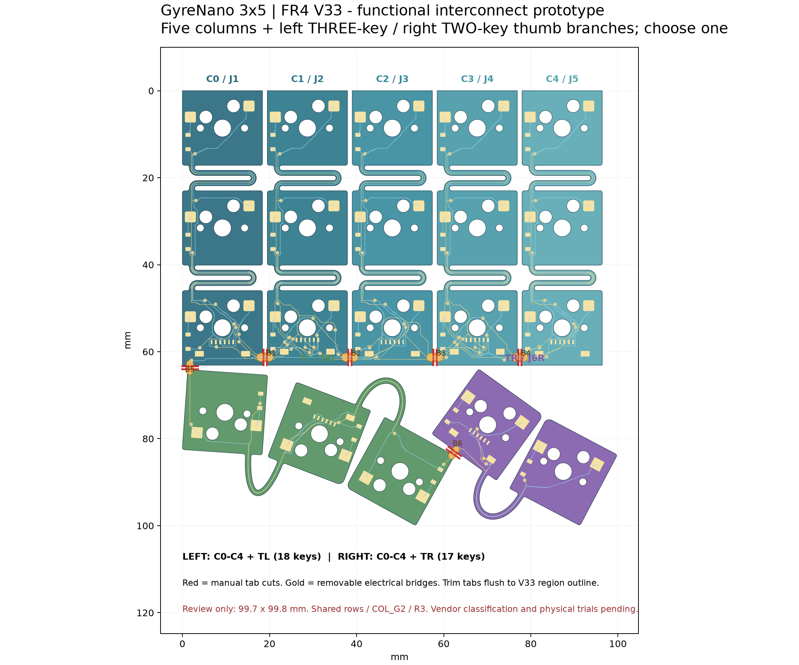

# FR4 keyfield — V33

[简体中文](README.zh-CN.md)

Two-layer **0.6 mm FR4 / 1 oz**, **99.700 × 99.804 mm**. Original key positions, thin connecting arms and retainer contact patches are preserved. This reorganization does not change the PCB, Gerbers or EDA project bytes.

- [KiCad project](kicad/GyreNanoKeyfieldFR4V33.kicad_pro), [PCB](kicad/GyreNanoKeyfieldFR4V33.kicad_pcb), [schematic](kicad/GyreNanoKeyfieldFR4V33.kicad_sch).
- [Fabrication ZIP](fabrication/GyreNanoKeyfieldFR4V33-Gerber.zip): the previously delivered KiCad upload file, unchanged.
- [Native JLCEDA project](eda/GyreNanoKeyfieldFR4V33/GyreNanoKeyfieldFR4V33.eprj3); keep its complete folder. [Portable project ZIP](eda/deliverables/GyreNanoKeyfieldFR4V33-EDAProject.zip): extract before opening; this is not a Gerber ZIP.
- [V32 isolated-region alternative](alternative-isolated/README.md), kept separately.

Five main-column FFCs plus one selected thumb FFC are required per half. Populate C0–C4 + TL for 18 left keys, or C0–C4 + TR for 17 right keys. Do not connect both thumb alternatives simultaneously.

| Bridges | Connected signals |
| --- | --- |
| C0–C1, C1–C2 | R0, R1, R2, COL_G2 |
| C2–C3, C3–C4 | R0, R1, R2 |
| C0–TL | COL_G2 |
| TL–TR | R3 |

**Remove all six cross-region bridges and trim flush before curved installation.** Retain the original intra-column/thumb arms. Cut unpowered, remove copper burrs, then check continuity and isolation. An intact blank supports flat electrical testing; it has not been validated as an intact curved assembly.

Recorded [DRC](checks/drc.json), [ERC](checks/erc.json), [native parity](checks/native.json), [128 cut/hand cases](checks/cuts.json), [contact/edge clearance](checks/interconnect.json) and [static-fit inheritance](checks/trim-fit.json) pass. EDA validation is under [eda/checks/](eda/checks/). Historical reports retain original paths; the release migration manifest maps their files to this layout.

Thin FR4 forming, fatigue, physical cutting and assembly remain unqualified. The user reports uploading the KiCad version; fabrication acceptance/delivery is not independently confirmed. 0.4 mm was discussed but **not applied**. No coupon or single-board classification approval is claimed.

Editable native projects are self-contained. The generation pipeline and locked cross-version inputs are in the [engineering snapshot](../../docs/DEVELOPMENT.md).
